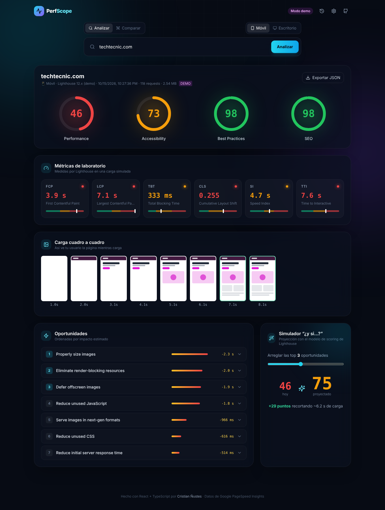
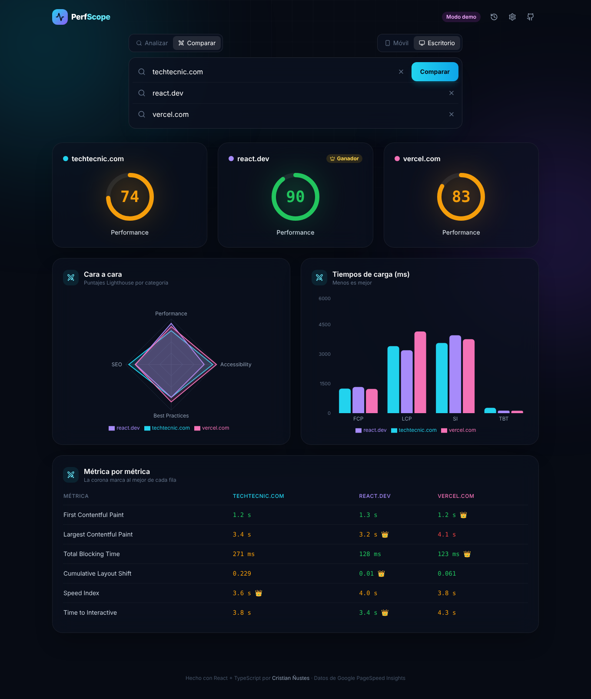

<div align="center">

# ⚡ PerfScope

**Analyze, compare and track web performance with Google Lighthouse — in a beautiful, fast React app.**

[**🚀 Live demo**](https://crnustes.github.io/perfscope/) · [Report a bug](https://github.com/Crnustes/perfscope/issues)




</div>

## ✨ Features

- **Core Web Vitals** — lab metrics (FCP, LCP, TBT, CLS, SI, TTI) and real-user field data from the Chrome UX Report (LCP, INP, CLS, TTFB), rated with Google's official thresholds.
- **Animated score gauges** for Performance, Accessibility, Best Practices and SEO.
- **Load filmstrip** — see the page paint frame by frame, with the LCP moment highlighted.
- **"What if?" simulator** — re-implements Lighthouse's **log-normal scoring curves** to project the score you'd reach by fixing the top N opportunities.
- **Battle mode** — compare up to 3 sites **in parallel** with radar + bar charts and a per-metric winner.
- **History & trends** — every audit is persisted locally and plotted over time.
- **Shareable links** — state lives in the URL (`?url=site.com&strategy=desktop`), so any report can be sent to a client.
- **Demo mode** — deterministic, seeded fake reports for presentations or when the public API quota runs out.
- Export any report as JSON · keyboard shortcut <kbd>/</kbd> · fully responsive.



## 🧠 Engineering highlights

| Area | Approach |
|---|---|
| Data fetching | **TanStack Query** with `useQueries` for parallel audits, per-request `AbortSignal` cancellation, caching and stale times |
| State | **Zustand** store with `persist` middleware (settings + history), versioned storage, history capped & stored without screenshots |
| Domain logic | Typed normalization layer that turns the large PSI/Lighthouse payload into a small `Report` model, decoupling UI from the API |
| Scoring | Port of Lighthouse's log-normal curve (with an erfc approximation) to estimate scores from raw metrics |
| Errors | Typed `PsiError` (quota / unreachable / invalid URL / network) with contextual recovery actions in the UI |
| Performance | Route-level **code splitting** (`React.lazy` + `Suspense`) and vendor chunking for charts and animations |
| UX | Framer Motion animations (motion values, layout animations, spring drawers), skeleton "scanning" state, accessible dialogs |
| Quality | Strict TypeScript, **Vitest** unit tests, CI pipeline that tests → builds → deploys to GitHub Pages |

## 🏗️ Architecture

```
src/
├── lib/
│   ├── psi.ts          # PageSpeed Insights client + response normalization
│   ├── metrics.ts      # Types, thresholds, ratings, Lighthouse scoring model
│   ├── demo.ts         # Seeded (deterministic) demo report generator
│   ├── useReport.ts    # TanStack Query hooks (single + parallel audits)
│   └── metrics.test.ts # Unit tests
├── store/useAppStore.ts  # Zustand + persist (settings, history)
├── components/
│   ├── Report.tsx      # Gauges, metric cards, filmstrip, opportunities, simulator, trend
│   ├── Compare.tsx     # Lazy-loaded battle mode
│   └── ui.tsx          # Design system primitives
└── App.tsx             # Layout, URL routing, search, drawers
```

## 🚀 Getting started

```bash
git clone https://github.com/Crnustes/perfscope.git
cd perfscope
npm install
npm run dev     # http://localhost:5173
npm test        # unit tests
npm run build   # production build
```

> The app works without an API key using Google's shared public quota. For heavy use, add a free
> [PageSpeed Insights API key](https://developers.google.com/speed/docs/insights/v5/get-started#APIKey) in **Settings** — it's stored only in your browser.

## 👤 Author

**Cristian Ñustes** — Web Developer · [cristian.click](https://cristian.click) · [Tech Tecnic](https://techtecnic.com)

MIT License
